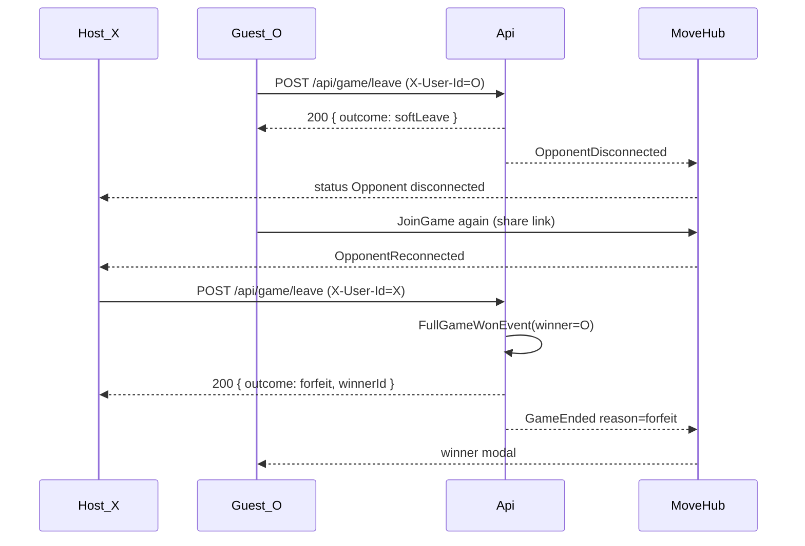
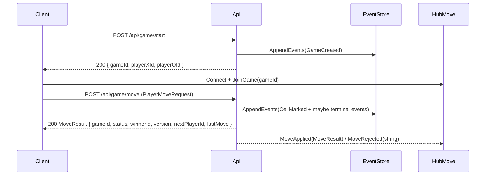
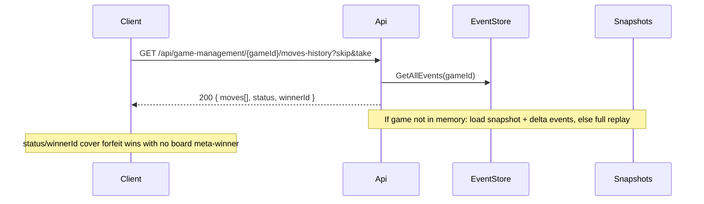
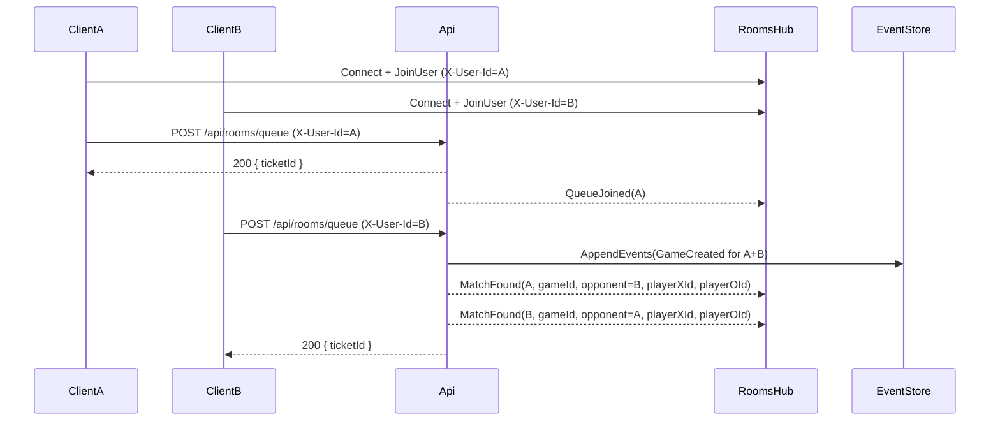
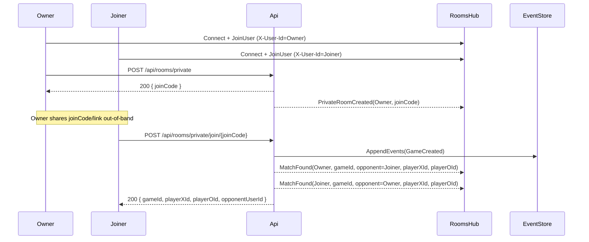
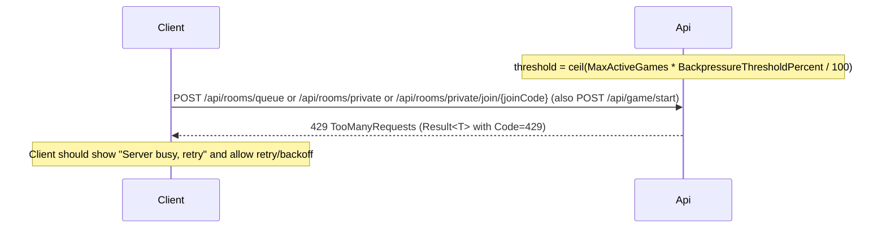

# User flows (frontend reference)

This document describes the primary frontend user flows and how they map to backend HTTP + SignalR.

## Conventions
- Identity: `X-User-Id: <guid>` header.
- Scalar (dev): `/scalar/v1`
- Game hub: `/move-updates-hub`
- Rooms hub: `/rooms-hub`
- `MatchFound` payload: `{ ticketId, gameId, opponentUserId, playerXId, playerOId }` (player ids = user GUIDs; X is room `Players[0]`)
- **Host** = `playerXId` (room `Players[0]` / first queue seat / private room creator). Guest = `playerOId`.

## Leave game (host forfeit / guest soft-leave)



- Hub events: `GameEnded`, `OpponentDisconnected`, `OpponentReconnected` (plus existing `MoveApplied` / `MoveRejected`).
- Moves history also returns `status` + `winnerId` so forfeit survives refresh.
- Front UX: guest soft-leave **keeps** `sessionStorage` game session (share-link rejoin); host forfeit **clears** it. Off-turn / illegal clicks use a fixed toast (no layout jump). Theme is chosen on Auth/Matchmaking only (locked in-game).

## Ops probes
- Deploy / ALB liveness: `GET /health/live` (JSON `{ status, checks }`, no descriptions).
- Readiness (Mongo when `HealthChecks:MongoEnabled`): `GET /health/ready`.

## Start game and play moves



`MoveResult` is shared by HTTP and SignalR so peers apply the last move locally (no full history refetch per move). Clients still load history on enter/reconnect.

## Reconnect / resume (history + rehydrate)



## Regular matchmaking (queue -> match -> game)



## Private room (create -> share code -> join -> game)



## Expiry flows (best-effort notifications)

```mermaid
sequenceDiagram
  participant Worker
  participant Api
  participant RoomsHub
  participant Mongo

  Note over Mongo: TTL deletes are eventual; worker sweeps frequently
  Worker->>Mongo: Find expired queued tickets / half-full rooms
  Worker-->>RoomsHub: QueueExpired(userId, ticketId)
  Worker-->>RoomsHub: RoomExpired(userId, roomId, type)
```

## Backpressure (near capacity -> 429)



